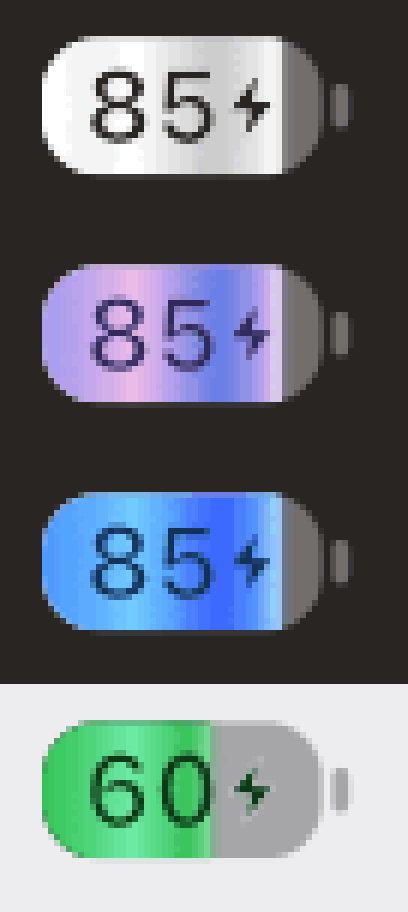

# Battery Manager for Mac

[](LICENSE)

Battery Manager is a menu bar app that keeps your MacBook's battery from sitting at 100% while
plugged in, which slows long-term capacity loss. It sets a charge limit, keeps it in sync with macOS's
own Charge Limit in System Settings, and replaces Apple's battery menu with one that shows everything
Apple's does plus the limit controls. It runs on Apple Silicon and Intel Macs with macOS 13 or later,
including macOS 27, whose firmware removed the SMC charge keys other tools relied on.

**[Download the latest release](https://github.com/somealtmail-sudo/Battery-Manager-for-Mac/releases/latest)** · [What's new](CHANGELOG.md) ·
[Report a problem](https://github.com/somealtmail-sudo/Battery-Manager-for-Mac/issues)

<p align="center"></p>
<p align="center"><sub>The menu bar battery while charging, enlarged: Automatic, Ultracode, Blue and Green.</sub></p>

This repository holds Battery Manager's releases and documentation; the source code isn't public.

## Features

- **Charge limit**: charging stops at the limit and the Mac runs off the adapter. 80–100% on
  macOS 27 (macOS's own limit), 20–100% elsewhere, with an opt-in for lower limits on macOS 27.
- **Sailing range**: once stopped, charging resumes only after the battery drops N% below the limit,
  so the battery isn't micro-cycled.
- **Discharge to limit**: if you're above the limit while plugged in, run from battery down to it.
  On Macs that use macOS's own limit this is a choice in Settings › Charging: **Discharge to the
  limit** (System Settings always shows your limit) or **Hold the current charge**.
- **Top up**: charge to 100% once (e.g. before a trip). The charge is kept until you unplug; then
  the limit applies again.
- **Calibration**: charge to 100%, run down to 15%, charge to 100%, hold for an hour, then return
  to the limit, so the battery gauge relearns its capacity.
- **Heat protection**: pause charging while the battery is above a temperature (35 °C by default).
- **MagSafe light**: default, off, or "show limit" (green once held at the limit).
- **No charging past the limit while asleep**: macOS's own limit and Intel's firmware limit hold
  through sleep by themselves, and in hold mode the limit is put back at yours before the Mac sleeps
  on battery, so plugging in while it's asleep can't charge past it. Macs with SMC charge keys pause
  charging before sleep (and can stay awake until the limit is reached). See
  [Caveats](#caveats) for the two setups where sleep still charges.
- **Power and health**: adapter → Mac → battery power flow, charger name and wattage, hardware
  percentage, health, capacity, cycles, temperature (now and lifetime) and a daily health chart.
- **Notifications** when the limit is reached, a top-up or calibration finishes, heat protection
  pauses charging, macOS starts its own calibration, or the helper stops.
- **Automation**: `batterymanager://` links for Shortcuts and a `batteryd` CLI.
- **Replaces Apple's battery icon**: the menu bar item looks like Apple's battery and its menu
  starts with everything Apple's Battery menu shows, with the charge limiter below.

## Download & install

### Requirements

- A Mac with a battery, running **macOS 13 or later**, **Apple Silicon or Intel** (the app is
  universal).
- An administrator password to install, update or remove the helper.
- **macOS 27**: charge limiting goes through macOS's own Charge Limit (80–100%; lower limits are an
  opt-in), which holds through sleep, restarts and shutdown, and the menu runs in the status item
  session like Apple's. macOS 26 and later get the Liquid Glass menu. Other Macs use the backend
  their firmware supports ([How it works](#how-it-works)).

### Install

1. Download the latest **Battery-Manager-x.y.z.dmg** from
   [Releases](https://github.com/somealtmail-sudo/Battery-Manager-for-Mac/releases/latest). Each release also lists SHA-256 checksums in
   `SHA256SUMS.txt`; compare with `shasum -a 256 ~/Downloads/Battery-Manager-*.dmg`.
2. Open the DMG and drag **Battery Manager** onto **Applications**.
3. Open **Battery Manager** from Applications. The app is ad-hoc signed and not notarized by Apple
   (that needs a paid Developer ID), so the first time macOS refuses to open it:
   1. Click **Done** in the warning (not Move to Trash).
   2. Open **System Settings › Privacy & Security**, scroll to the message about Battery Manager,
      click **Open Anyway** and confirm with your password or Touch ID.
   3. Confirm once more in the dialog that follows (**Open** or **Open Anyway**).

   Or, before opening it, clear the download quarantine in Terminal:

   ```sh
   xattr -dr com.apple.quarantine "/Applications/Battery Manager.app"
   ```

   Either way it's needed once per downloaded version.
4. Click the battery icon in the menu bar, open **Battery Manager Settings… › Helper**, click
   **Install Helper** and enter an administrator password. The helper is the small root service
   that actually switches charging ([what gets installed](#what-gets-installed)). Until it's
   installed, Macs with macOS's own Charge Limit still get the limit (the app can set it as you);
   everything else needs the helper.
5. Recommended: hide Apple's battery icon, so only this one remains: in **System Settings › Menu
   Bar**, set **Battery** to **Don't Show in Menu Bar** (on macOS 15 and earlier: **System Settings
   › Control Center › Battery**, turn off **Show in Menu Bar**). And turn on **Launch at login** in
   Settings › General.

### Update

Download the new DMG, quit Battery Manager (Settings › Helper › **Quit Battery Manager**, or the
same item at the bottom of its menu after 1.0.0), drag the new version onto Applications (replace
the old one) and open it (allow it as in step 3). When the installed helper is from a different
version the app offers **Update Helper** in Settings › Helper; click it and enter an administrator
password. Your settings are kept.

### Uninstall

In **Settings › Helper**, click **Uninstall Battery Manager…** and enter an administrator password.
It stops the helper, hands macOS's own charge limit, the adapter and the MagSafe light back as they
were, and removes the helper and its files. If Battery Manager is still in Applications afterwards,
drag it to the Trash.

Either way your health history (`~/Library/Application Support/BatteryManager`) and the app's
preferences (`defaults delete local.batterymanager.app`) stay until you delete them. If macOS's
limit can't be restored, the uninstaller says so; set it in System Settings › Battery.

### What gets installed

| Path | What |
| --- | --- |
| `/Applications/Battery Manager.app` | The menu bar app (runs as you). It carries the helper and its installer. |
| `/Library/PrivilegedHelperTools/local.batterymanager.daemon` | The helper (root-only directory) |
| `/usr/local/bin/batteryd` | A symlink to it, for the CLI (when `/usr/local/bin` exists) |
| `/Library/LaunchDaemons/local.batterymanager.daemon.plist` | Starts the helper as root at boot and keeps it running |
| `/Library/Application Support/BatteryManager/` | `config.json` (your settings, owned by you), `status.json` (written by the helper) |
| `/var/log/batteryd.log` | The helper's log |

## The battery menu

macOS doesn't let other apps add items to Apple's own Battery menu (it belongs to Control Center),
so this app reproduces it instead. Hide Apple's icon in **System Settings › Menu Bar › Battery ›
Don't Show in Menu Bar** (on macOS 15 and earlier, **Control Center › Battery**, turn off **Show in
Menu Bar**), so only this one remains. Apple's menu is unchanged and still available in Control
Center.

The menu uses the same Liquid Glass as Apple's menus on macOS 26+ and, on macOS 27, the status
item's expanded-interface session, so it tracks like a real menu. The top mirrors Apple's
(measured from macOS 27):

- **Battery**, **Power Source**, and while plugged in the charging state (`Fully Charged`,
  `1:05 Until Full`, `Battery Is Not Charging`, …), reported against macOS's Charge Limit as
  Apple's does on macOS 27 (`Charging to 80% Limit`, `Charged to 80% Limit`)
- **Energy Mode** with a **Low Power** toggle. Low Power Mode needs root, so the helper applies it
  with `pmset` for the current power source.
- **Using Significant Energy**: the same query Control Center makes
  (`systemstats_get_top_coalitions`: the last 120 s, top 5, at least 500 energy units per second),
  keeping only installed apps, so both menus list the same apps. Click one to switch to it. On
  battery with a very bright built-in display it also lists **Display Brightness**; click it to dim
  to 75%.
- **Battery Settings…**

Below that: **Charge Limit** (switch, slider, live status), **Top Up** and **Discharge to Limit**
toggles, a **Power** summary, **macOS Battery Settings…** and **Battery Manager Settings…** for
everything else, and **Quit Battery Manager**.

Right-click (or Control/Option-click) the icon for Apple's options: **Show Percentage**, **Show
Energy Mode** (Always / When Active) and **Remove** (quits the app; the helper keeps enforcing the
limit). The icon matches Apple's too: the percentage inside the battery, a bolt while charging and
a plug when on power but not charging (e.g. held at the limit), a yellow fill in Low Power Mode and
red at 10% or less. While plugged in, the fill flows like liquid in a color and at a speed you pick
(Settings › General › Menu Bar, which can also turn the animation off).

## How it works

```
 Battery Manager.app (you)                     batteryd (root LaunchDaemon)
 ─────────────────────────                     ────────────────────────────
 reads battery via IOKit           config.json  reads config, battery %, decides
 edits settings  ───────────────────────────►   what to do (ChargePolicy)
 shows helper state ◄─────────────────────────  drives macOS's limit / SMC keys,
                                   status.json  writes status.json
```

| Piece | Runs as | Role |
| --- | --- | --- |
| Battery Manager.app | you | Menu bar app: the battery menu, Settings, and the helper's installer |
| `batteryd` | root | The helper: a LaunchDaemon that enforces the charge policy, plus a CLI |

The app bundle carries the helper (`Contents/MacOS/batteryd`), its LaunchDaemon plist and
`Contents/Resources/install-helper.sh`. **Install Helper** runs that script as root through macOS's
administrator prompt; it copies `batteryd` to `/Library/PrivilegedHelperTools` (writable only by
root, unlike `/usr/local/bin`, which Homebrew leaves owned by your account), installs the plist and
starts the daemon. The helper reports its version, so the app can tell when it's from a different release.

The daemon picks a backend by what the Mac can do (never by macOS version; `batteryd probe` shows
yours):

| Backend | Macs | How |
| --- | --- | --- |
| `CHTE` | Apple Silicon, macOS 15–26 firmware | SMC `01000000` stop charging, `00000000` allow |
| `CH0B` + `CH0C` | Apple Silicon, older firmware | SMC `02` stop charging, `00` allow |
| macOS Charge Limit | Apple Silicon, macOS 26.4+; the only option on macOS 27 firmware | Private `PowerUISmartChargeClient` (`setMCLLimit:error:`), the API behind System Settings › Battery › Charge Limit. Accepts 80–100 |
| Adapter control | any Mac with the key | SMC `CHIE` `08` (or `CH0J`/`CH0I` `01`) runs from battery while plugged in, `00` reconnects |
| `BCLM` | Intel | firmware max charge % |

On macOS 27 (and the firmware shipped with 26.7/15.8) Apple removed `CHTE`/`CH0B` and gated the
newer keys behind a private entitlement, so the daemon drives macOS's own limit instead. That limit
is enforced by macOS and the firmware, so it also holds through sleep, restarts and shutdown. Notes:

- macOS drains the battery down to its limit while plugged in (measured on macOS 27: about 0 W
  from the adapter until it gets there). Settings › Charging › **When above the limit** picks what
  happens when you're above your limit (the menu's **Discharge to Limit** toggle is the same switch):
  - **Discharge to the limit**: macOS's limit always equals yours, so System Settings shows it and
    the Mac runs from battery down to it.
  - **Hold the current charge**: the daemon sets macOS's limit to the current level and lets it
    follow the charge down, so System Settings shows that level until the battery reaches your
    limit. Lowering the limit in System Settings then discharges to it once instead of being undone.
    The held level is at most 99%, because 100% turns macOS's limit off.
  Heat protection only pauses charging; it never stops a discharge to the limit.
- The daemon saves macOS's limit before changing it and restores it when you turn limiting off or
  uninstall. If you move the slider in System Settings, the app adopts that value.
- macOS 27 occasionally charges to 100% to recalibrate the battery gauge and ignores every limit
  meanwhile. The app detects this (`com.apple.system.powersources.chargingtofulloverride`), shows
  it, and doesn't fight it.
- **Allow limits below 80%** (Settings › Charging) first tries PowerUIAgent's preferences
  (`mclLimitValue` plus the `com.apple.smartcharging.defaultschanged` reload), which macOS accepts
  on many Macs. If that doesn't stick, the limit is held with adapter control instead: the Mac runs
  from battery down to the bottom of the sailing range, then charges back up (macOS's limit stays at
  80% as a safety net).
- A normal user may set macOS's limit too, so the app applies it itself if the helper isn't
  installed yet or is too old.

The daemon re-evaluates every 30 s, as soon as the app saves settings, on every power-source change,
and on sleep/wake. When it stops it reconnects the adapter and restores SMC charging; `batteryd
release` (run by the uninstaller) also hands macOS's limit and the MagSafe light back.

## Automation

### CLI

The helper links `batteryd` into `/usr/local/bin` when that directory exists. If `batteryd` isn't
found, use the helper's full path, `/Library/PrivilegedHelperTools/local.batterymanager.daemon`
(read-only commands like `status` and `probe` don't need root):

```sh
batteryd status              # battery, backend, macOS limit, config, daemon state
batteryd limit 80
batteryd enable | disable
batteryd discharge on | off  # above the limit: discharge to it, or hold the current level
batteryd top-up
batteryd calibrate [cancel]
batteryd heat on 35 | off
batteryd led system | state | off
batteryd probe               # which charge-control keys and APIs this Mac has
# Root commands: use the full path, never one through a directory you can write to.
sudo /Library/PrivilegedHelperTools/local.batterymanager.daemon adapter off  # manual override; the daemon re-applies its policy within 30 s
```

Logs: `/var/log/batteryd.log`.

### Links

For Shortcuts' **Open URL** action or `open` in scripts: `batterymanager://limit/80`, `enable`,
`disable`, `topup`, `topup/cancel`, `discharge/on`, `discharge/off`, `calibrate`, `calibrate/cancel`,
`lowpower/on`, `lowpower/off`, `settings`, `menu`. Like their buttons, `topup` and `calibrate` need
the helper (only it finishes them). Any app or web page can open these links, so the ones that let
the battery charge further (`disable`, raising `limit`, `topup`, `calibrate`) ask first, unless you
allow them in Settings › General; lowering or restoring the limit never asks.

## Feedback

Found a bug or have a request? [Open an issue](https://github.com/somealtmail-sudo/Battery-Manager-for-Mac/issues). For bugs, include your Mac model,
your macOS version, the output of `batteryd status` and `batteryd probe` (or
`/Library/PrivilegedHelperTools/local.batterymanager.daemon status` and `… probe` if `batteryd`
isn't found), and the relevant part of `/var/log/batteryd.log`.

## Caveats

- **Use at your own risk.** These are undocumented SMC keys and private APIs. Apple has changed them
  before (`CH0B` → `CHTE` in macOS 15, then removed both in macOS 27) and may again. The macOS-limit
  driver checks every selector's signature first and reports "unsupported" rather than guessing.
- On Macs using SMC keys, the SMC charges normally while the Mac is shut down.
  macOS's own limit doesn't have that gap.
- macOS's **Optimized Battery Charging** can conflict with the SMC backends; turn it off in System
  Settings → Battery.
- Holding a limit below 80% with adapter control runs the Mac from battery between the sailing
  range and the limit, adding a few shallow cycles a day, and only while the Mac is awake: whenever
  it sleeps on the charger, macOS charges it to 80% (its lowest limit), and it runs back down after
  waking. Macs with adapter control but no charge limit at all charge to 100% while asleep. The
  helper can't watch the battery while the Mac sleeps, so it never leaves it running from battery.
- The settings file is owned by your user so the app needs no password to change it. The daemon
  clamps every value it reads, so editing it can only change charging behaviour, Low Power Mode and
  the MagSafe light, not do anything else as root.
- The app isn't notarized, so macOS asks you to allow each downloaded version once (see
  [Install](#install)).

## License

Battery Manager is licensed under
[Creative Commons Attribution-NonCommercial-ShareAlike 4.0](https://creativecommons.org/licenses/by-nc-sa/4.0/)
([full text](LICENSE)). In short:

- **Free to use, share and modify**, as long as you give credit and link to the license.
- **No commercial use**: you may not sell it or use it primarily for commercial advantage.
- **Share alike**: if you distribute a modified version, it must be under the same license.

This summary isn't a substitute for the license.

### Disclaimer

Battery Manager is provided as is, without warranty of any kind. It changes how your Mac charges
through undocumented interfaces; you use it at your own risk, and the authors aren't liable for any
damage to your Mac, its battery or your data. It isn't affiliated with or endorsed by Apple. Mac, macOS and
MagSafe are trademarks of Apple Inc.
